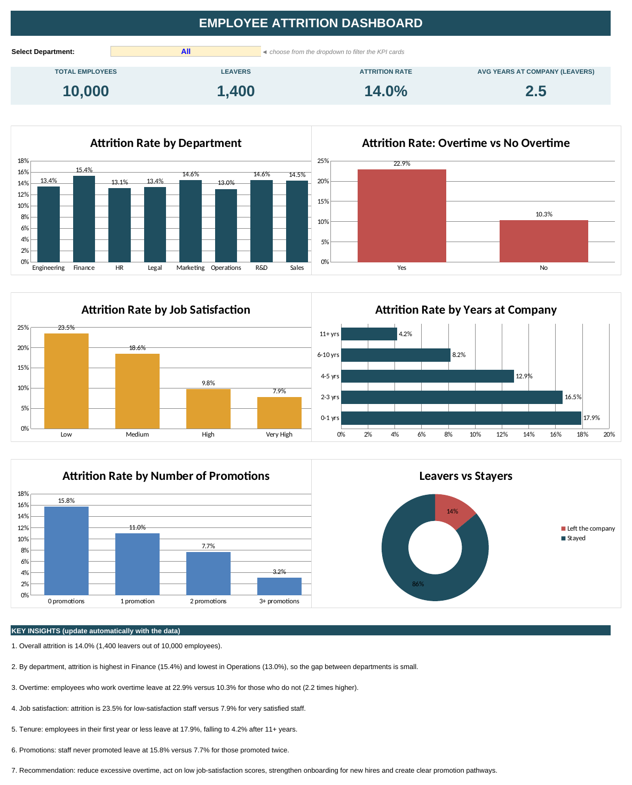

# Employee Attrition Analysis & Dashboard (Excel)

Capstone project for the 3MTT Data Analytics & Visualisation programme.
Prepared by: Bello Olusola Samuel (FE/23/56185998)

## Business problem
Employee turnover raises recruitment costs and disrupts operations. This project measures attrition and identifies the factors linked to it.

## Dataset
Kaggle employee attrition and performance dataset: https://www.kaggle.com/datasets/carlospereavega/employee-attrition-performance?resource=download     10,000 employees, 22 columns.

## Tools
Microsoft Excel: data checks, IF formulas, COUNTIFS/AVERAGEIFS, charts, dropdown filter.

## Method
Raw Data → Cleaned Data → Analysis → Dashboard.

## Key findings
- Overall attrition: 14.0% (1,400 of 10,000 employees)
- Overtime: 22.9% attrition vs 10.3% without overtime
- Low job satisfaction: 23.5% vs 7.9% for very satisfied staff
- First year or less: 17.9%, falling to 4.2% after 11+ years
- Never promoted: 15.8% vs 7.7% for twice promoted

## Recommendations
Reduce excessive overtime, act on low job satisfaction, strengthen onboarding, and create clear promotion pathways.

## Files
- `Employee_Attrition_Dashboard_Capstone.xlsx`: full workbook (download to open)
- `employee_attrition_performance.csv`: original data

## Dashboard preview

## Demo video
[Watch the demo video]([paste your video link here])
